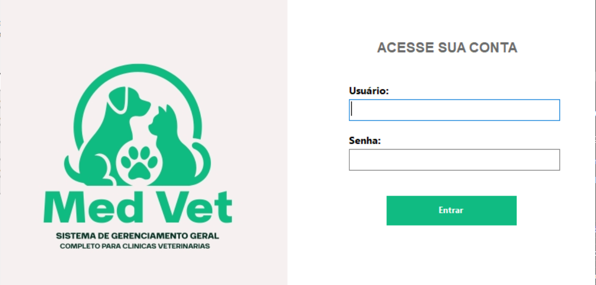
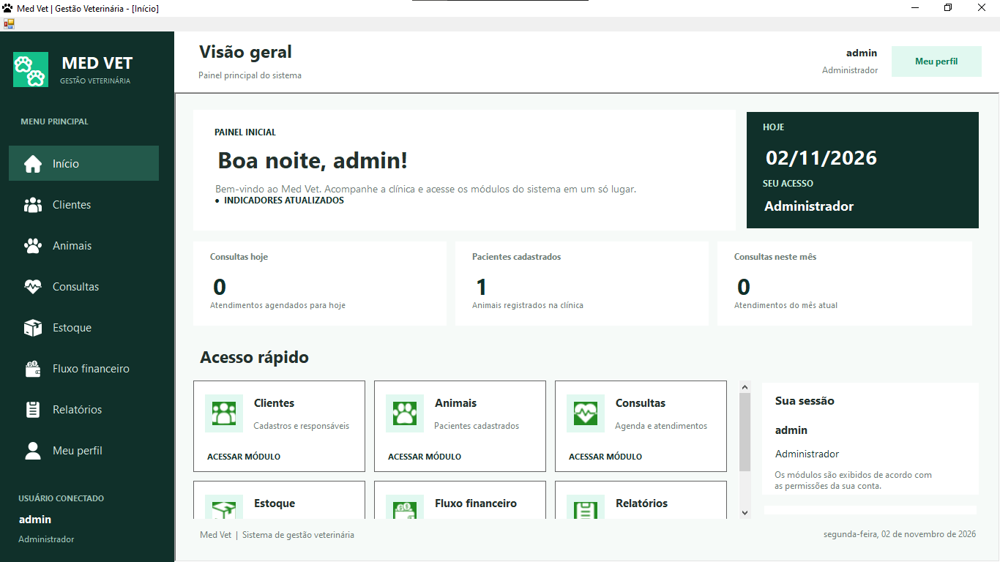
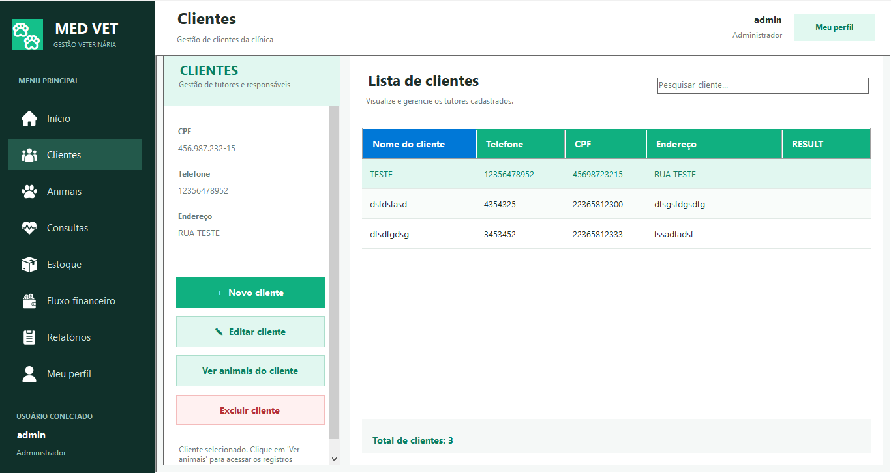
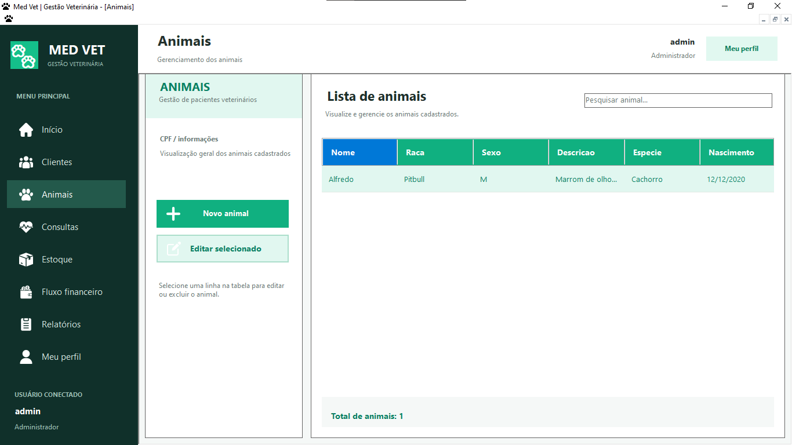
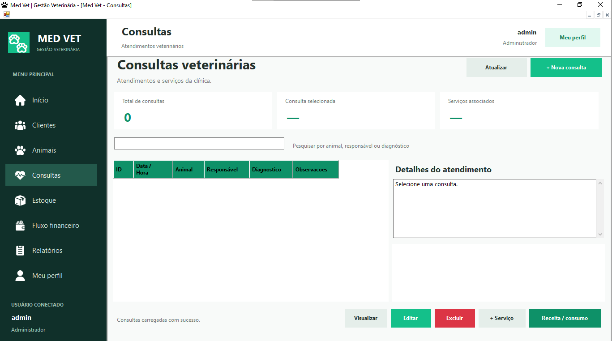
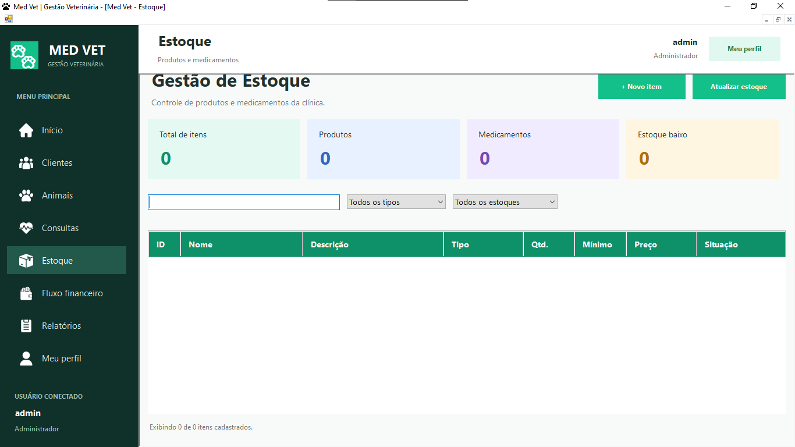
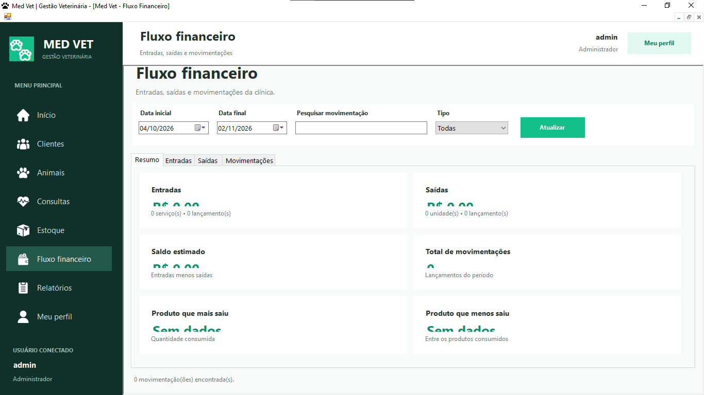
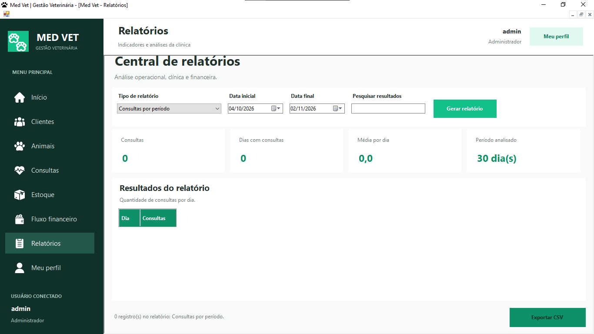
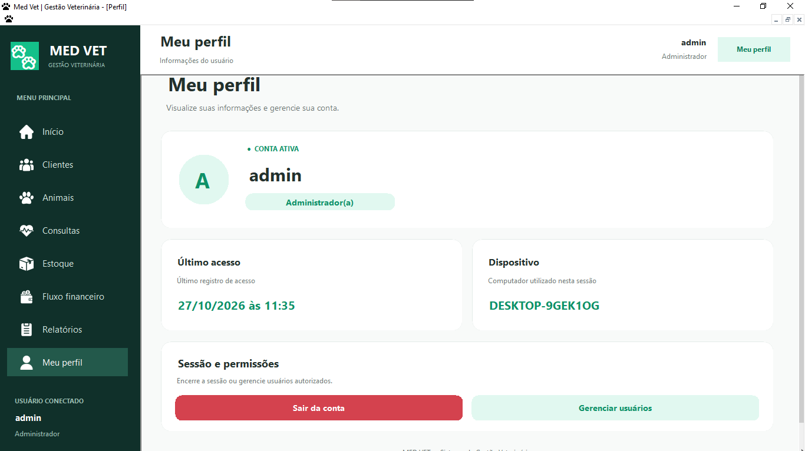

# 🐾 Med Vet — Sistema de Gerenciamento de Clínica Veterinária

Aplicação desktop para apoiar a rotina de uma clínica veterinária: cadastro de tutores e pacientes, registro de consultas com serviços, produtos e prescrições, controle de estoque, fluxo financeiro e relatórios.

Projeto acadêmico da disciplina **Desenvolvimento de Sistemas**, desenvolvido em equipe.

> ⚠️ **Status:** projeto acadêmico. Uma auditoria de segurança e testes completos ainda são necessários antes de qualquer uso em produção.

---

## 📑 Sumário

- [Equipe e orientação](#-equipe-e-orientação)
- [Tecnologias](#-tecnologias)
- [Funcionalidades](#-funcionalidades)
- [Perfis de acesso](#-perfis-de-acesso)
- [Banco de dados](#-banco-de-dados)
- [Estrutura dos repositórios](#-estrutura-dos-repositórios)
- [Como executar](#-como-executar)
- [Segurança](#-segurança)
- [Limitações conhecidas](#-limitações-conhecidas)
- [Demonstração](#-demonstração)
- [Licença](#-licença)

---

## 👥 Equipe e orientação

**Desenvolvedores:** Murilo Santos, Matheus Barros, Alison Strob, Arthur Mello, Gabriel Bleinat, Kaio Eduardo, André Iori e Ruan Megliorini.

**Professores:** Emerson e Anderson.

**Disciplina:** Desenvolvimento de Sistemas.

---

## 🛠 Tecnologias

| Categoria | Tecnologia |
|---|---|
| Linguagem | C# |
| Plataforma | .NET Framework 4.7.2 |
| Interface | Windows Forms (interface MDI) |
| Banco de dados | Microsoft SQL Server |
| Acesso a dados | ADO.NET (`System.Data.SqlClient`), DataSet tipado com TableAdapters e comandos SQL parametrizados |
| Criptografia de senhas | [BCrypt.Net-Next](https://www.nuget.org/packages/BCrypt.Net-Next) 4.2.0 |
| Geração de PDF | PDFsharp-GDI e PDFsharp-MigraDoc-GDI 6.5.0 |
| Ferramentas | Visual Studio 2022, SQL Server Management Studio (SSMS), Git/GitHub |

---

## ✨ Funcionalidades

### 🔐 Login e sessão
- Autenticação com usuário e senha consultando o SQL Server; as senhas são verificadas com BCrypt.
- Validação de campos obrigatórios, mensagem para credenciais incorretas e aviso após três tentativas inválidas.
- Logout com confirmação e retorno à tela de login.

### 🏠 Dashboard
- Saudação personalizada, nível de acesso do usuário e data atual.
- Indicadores: consultas do dia, animais cadastrados e consultas do mês.
- Atalhos para os módulos, exibidos conforme as permissões do usuário.

### 👨‍⚕️ Funcionários *(somente administradores)*
- Cadastro, listagem, edição e exclusão.
- Pesquisa por nome, login, telefone ou CRMV.
- Redefinição de senha (nova senha gravada como hash BCrypt).
- Verificação de login e CRMV duplicados.
- Contas administradoras protegidas contra edição e exclusão nessa tela.
- Exclusão bloqueada quando o funcionário possui consultas vinculadas.
- Indicadores com o total de usuários por tipo de acesso.

### 🧑 Clientes (tutores)
- Cadastro, listagem, pesquisa, edição e exclusão.
- Acesso direto aos animais de cada cliente.
- Exclusão bloqueada quando o cliente possui animais.

### 🐶 Animais (pacientes)
- Cadastro, listagem, pesquisa, edição e exclusão.
- Cada animal é associado a um cliente responsável, com data de nascimento.
- Filtro dos animais por cliente.

### 📅 Consultas
- Cadastro, edição, listagem, filtro e exclusão de consultas, com seleção do animal e do veterinário responsável, data/hora, diagnóstico e observações.
- Exclusão bloqueada quando há registros vinculados (serviços, produtos, prescrições, movimentações).
- Acesso, a partir da consulta, aos serviços, produtos consumidos e prescrições.

### 💉 Serviços da consulta
- Seleção de serviços do catálogo, com quantidade e subtotal.
- O preço do serviço no momento do lançamento fica gravado na consulta, preservando o valor histórico.

### 📦 Estoque
- Cadastro, edição, detalhamento e exclusão de produtos e medicamentos, com estoque mínimo.
- Situação de cada item: normal, estoque baixo ou sem estoque.
- Baixa automática dos produtos consumidos em consultas, com bloqueio de consumo acima do disponível e estorno quando o lançamento é removido.
- Operações realizadas em transações SQL.

### 💊 Prescrições e receitas
- Prescrição vinculada à consulta: medicamento, quantidade, dosagem, frequência, duração e observações.
- Edição e exclusão com ajuste automático do estoque de medicamentos.
- **Geração da receita veterinária em PDF.**

### 💰 Fluxo financeiro
- Entradas (serviços) e saídas (produtos e medicamentos) geradas a partir dos lançamentos das consultas, sincronizadas na mesma transação SQL.
- Filtros por período e por tipo, abas de entradas e saídas, totais e saldo, com saídas destacadas em vermelho-claro.

### 📊 Central de relatórios
- Relatórios de consultas, serviços, prescrições, consumo de produtos, estoque de produtos, estoque de medicamentos, resumo financeiro e histórico financeiro.
- Filtro por período e **exportação em CSV** (compatível com o Excel).
- Cada relatório fica disponível conforme o perfil do usuário.

### 👤 Perfil do funcionário
- Nome, cargo/nível de acesso e avatar com a inicial do nome.
- Último acesso e computador utilizados, registrados localmente na máquina.
- Botão para gerenciar usuários (administradores) e para encerrar a sessão.

---

## 🔑 Perfis de acesso

O acesso é definido pelo campo `NivelAcesso` do funcionário.

| Nível | Perfil | Módulos disponíveis | Relatórios |
|---|---|---|---|
| `1` | Administrador | Todos, incluindo gerenciamento de funcionários | Todos |
| `2` | Atendente | Início, Clientes, Animais, Consultas, Relatórios e Perfil | Consultas e serviços |
| `3` | Veterinário | Início, Animais, Consultas, Relatórios e Perfil | Consultas, serviços e prescrições |

> Os módulos **Estoque** e **Fluxo financeiro** são acessíveis somente ao administrador.

---

## 🗄 Banco de dados

**Nome do banco:** `ClinicaVeterinaria`

### Tabelas

| Grupo | Tabelas |
|---|---|
| Pessoas | `Funcionarios`, `Clientes`, `Animais`, `Fornecedores` |
| Atendimento | `Consultas`, `Consulta_Servico`, `Consulta_Produto`, `Prescricao` |
| Catálogos | `Servicos`, `Produtos`, `Medicamentos` |
| Estoque | `Estoque_Produto`, `Estoque_Medicamento`, `Fornecedor_Produto`, `Fornecedor_Medicamento` |
| Financeiro | `Movimentacao_Financeira` |

Principais relacionamentos: `Clientes` 1:N `Animais`; `Animais` 1:N `Consultas`; `Funcionarios` 1:N `Consultas`; `Consultas` N:N `Servicos` e `Produtos`; `Consultas` 1:N `Prescricao` e `Movimentacao_Financeira`; `Produtos` e `Medicamentos` 1:1 com seus registros de estoque. As chaves estrangeiras usam `ON DELETE NO ACTION` para proteger registros vinculados.

### Objetos programáveis

- **Procedures:** `sp_LoginUser`, `sp_CadastrarFuncionario`, `sp_CadastrarCliente`, `sp_RegistrarConsulta`, `sp_RegistrarPrescicao` e `sp_SincronizarFinanceiroConsulta`.
- **Views:** `w_ConsultasDetalhadas` e `vw_Estoque`.

Os modelos conceitual e lógico (BrModelo, `.brM3`) e o script do modelo físico estão no repositório BackEnd.

---

## 📁 Estrutura dos repositórios

O projeto é dividido em dois repositórios:

| Repositório | Conteúdo |
|---|---|
| [**FrontEnd**](https://github.com/DSProjectVet/FrontEnd) | Aplicação Windows Forms (solução do Visual Studio) |
| [**BackEnd**](https://github.com/DSProjectVet/BackEnd) | Modelos do banco e scripts SQL |

```
BackEnd/
├─ modelo_conceitual/      modelo conceitual (BrModelo)
├─ modelo_logico/          modelo lógico (BrModelo)
├─ modelo_fisico/
│  └─ modelo_fisico.sql    criação do banco e das tabelas
├─ stored_procedures.sql   procedures, views e testes
└─ Atualizações_finais.sql ajustes finais: financeiro, CRMV e cadastro de funcionário

FrontEnd/
└─ Projeto_Vet/
   ├─ Projeto_Vet.sln
   └─ DSProjectVet/
      ├─ Dados/            DataSet tipado e TableAdapters
      ├─ Forms/
      │  ├─ CRUD/          tela de login
      │  ├─ CLASSES/       gerenciamento de usuários, relatórios, controles visuais
      │  └─ SCREENS/       clientes, animais, consultas, estoque, prescrições, perfil, financeiro
      ├─ App.config        conexão com o banco
      └─ Program.cs        ponto de entrada
```

---

## 🚀 Como executar

### Pré-requisitos

- Windows com **Visual Studio 2022** (carga de trabalho *Desenvolvimento para desktop com .NET*) e **.NET Framework 4.7.2**.
- Uma instância do **Microsoft SQL Server** (por exemplo, a edição Express ou Developer) à qual você tenha acesso.
- **SQL Server Management Studio (SSMS)** para executar os scripts.
- Git.

### 1. Clonar os repositórios

```bash
git clone https://github.com/DSProjectVet/FrontEnd.git
git clone https://github.com/DSProjectVet/BackEnd.git
```

### 2. Criar o banco de dados

No SSMS, conecte-se à sua instância do SQL Server e execute os scripts do repositório **BackEnd** na ordem abaixo.

1. `modelo_fisico/modelo_fisico.sql` — cria o banco `ClinicaVeterinaria` e as tabelas.
2. `stored_procedures.sql` — cria as procedures e as views.
3. `Atualizações_finais.sql` — atualiza `sp_CadastrarFuncionario`, torna o CRMV opcional e cria o suporte ao fluxo financeiro (colunas `Origem` e `IdOrigem` e a procedure `sp_SincronizarFinanceiroConsulta`).

### 3. Configurar a conexão

A aplicação lê a conexão com o banco de `FrontEnd/Projeto_Vet/DSProjectVet/App.config` (e de `Properties/Settings.settings`). A string de conexão que acompanha o código pertence ao ambiente de quem a editou e **deve ser substituída pela do seu ambiente** antes de executar o sistema.

Nos dois arquivos, localize o parâmetro `Data Source` das conexões `ClinicaVeterinaria_ConnectionString` e `ClinicaVeterinariaConnectionString` e informe o seu servidor, seguindo o modelo:

```
Data Source=<SEU_SERVIDOR>\<SUA_INSTANCIA>;Initial Catalog=ClinicaVeterinaria;Integrated Security=True;TrustServerCertificate=True
```

`Integrated Security=True` usa a autenticação do Windows (sem usuário e senha no arquivo). **Não publique no repositório a string de conexão do seu ambiente nem credenciais reais.**

### 4. Criar o primeiro administrador

O sistema não vem com usuário padrão. Crie o primeiro administrador pela procedure `sp_CadastrarFuncionario`, informando um hash **BCrypt** da senha escolhida (a aplicação usa custo 11):

```sql
USE ClinicaVeterinaria;
GO

EXEC dbo.sp_CadastrarFuncionario
    @Nome              = N'Administrador',
    @Login             = N'admin',
    @SenhaHash         = N'<HASH_BCRYPT_DA_SENHA>',
    @NivelAcesso       = '1',            -- 1 = Administrador
    @Telefone          = '11999999999',  -- 10 ou 11 dígitos
    @CRMV              = NULL,
    @Funcionarios_TIPO = '1';
```

Depois de entrar com esse usuário, os demais funcionários podem ser cadastrados pela tela **Perfil → Gerenciar usuários**.

### 5. Compilar e executar

1. Abra `FrontEnd/Projeto_Vet/Projeto_Vet.sln` no Visual Studio.
2. Aguarde a restauração dos pacotes NuGet (o repositório já inclui a pasta `packages/`).
3. Defina `DSProjectVet` como projeto de inicialização e pressione **F5**.

---

## 🔒 Segurança

- Senhas armazenadas apenas como **hash BCrypt**.
- Consultas SQL **parametrizadas**.
- Integridade referencial com chaves estrangeiras e bloqueio de exclusões de registros vinculados.
- Operações críticas (estoque, consultas, prescrições, financeiro) em **transações SQL** com `COMMIT` e `ROLLBACK`.
- Controle de acesso por perfil dentro da aplicação.

---

---

## 🎬 Demonstração

### Capturas de tela

| | |
|:---:|:---:|
| <br>**Login** | <br>**Início (dashboard)** |
| <br>**Clientes** | <br>**Animais** |
| <br>**Consultas** | <br>**Estoque** |
| <br>**Fluxo financeiro** | <br>**Relatórios** |

<!--
  Captura da tela de perfil (telaPerfil.png) fora do README por enquanto:
  ela exibe o nome do computador utilizado. Para publicá-la, gere uma nova captura
  (ou oculte o nome do dispositivo) e remova este comentário:

  | <br>**Perfil** | |
-->

### Vídeo demonstrativo

[](./video_medVet.mp4)

▶️ [**Assistir ao vídeo demonstrativo**](./video_medVet.mp4) (arquivo `video_medVet.mp4`, aproximadamente 90 MB)

---

## 📄 Licença

Distribuído sob a licença **MIT**. Consulte o arquivo `LICENSE` de cada repositório.

> A geração de PDF utiliza o PDFsharp 6.5.0 com a licença AGPL selecionada no código (`ReceitaPdfService`). Confira as implicações dessa licença antes de redistribuir o projeto.
